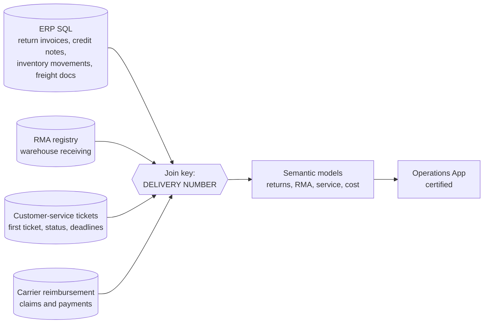

# Reverse Logistics Analytics

🇧🇷 [Leia em português](README.pt-BR.md)

End-to-end visibility of the post-sale chain of an e-commerce operation: **returns, credit notes, RMA receiving, customer-service tickets, cancellations, damages and carrier reimbursements**, all tied together by a single key, the delivery number.

> Power BI / Fabric semantic models, dataflows, SQL (ERP) and Power Query (M).
> Everything here is **sanitized or synthetic**. No company, customer, partner or real order is included.

## The problem

When an order goes wrong, the evidence is scattered: the ERP knows about the return invoice and the credit note, the warehouse knows what physically arrived, customer service knows what the customer was told, the carrier owes a reimbursement, and the marketplace may or may not have refunded. Each team had a partial view, so money was left on the table and nobody could say *where a returning order actually was*.

## The solution



- **One join key across systems** – the delivery number links ERP documents, RMA records, service tickets and settlements. Whitespace and format differences between systems are normalized in the dataflow, and duplicates are removed on the composite (delivery, original invoice).
- **Credit-note typing** – the ERP codes the type of credit (return, in-transit, virtual); the dataflow translates the codes into business statuses, which distinguishes a *physical return* from a *virtual credit* from a *return still travelling*.
- **RMA receiving** – warehouse records give the last return date, the reverse carrier and the invoice value; combined with the credit note they reveal two silent leaks: *received but not credited* and *credited but never received*.
- **Customer-service layer** – first-ticket date, handling status and deadlines per delivery, a cancellation queue that distinguishes new from forwarded cases, and a refund/withdrawal view.
- **Carrier reimbursement** – claims, expected dates and payments by carrier, so damaged or lost goods are chased on schedule.
- **Damage analysis** – service reasons and statuses grouped into a damage view per delivery, including reverse-carrier and posting code.
- **Return cost** – return freight (freight documents), RMA labor and inventory movements feed a per-return cost, which flows into the margin model.

Layered refresh: source dataflows run on their own schedule (daily to weekly depending on the volatility of the data), and the semantic models consume them, so a heavy model does not block a light one.

## Run the reference implementation

[`reference_implementation/return_stage.py`](reference_implementation/return_stage.py) shows how the stage of a return is derived from the joined facts, and which stages expose money or stock to a person's attention.

```bash
pip install pytest && pytest -q
```

## Design decisions worth noting

- **A single business key beats many technical joins** – every new source only needs to expose the delivery number.
- **Translate ERP codes once, in the dataflow** – dashboards speak business language.
- **Surface the silent leaks** – the two mismatches between physical and financial states are first-class statuses.
- **Separate refresh rhythms** – volatile sources refresh often; slow ones don't.

<!-- RESULTS: add measurable outcomes later (value recovered from carriers, returns without credit found, turnaround time, tickets resolved on time). -->

## About

Built and maintained by [Bárbara Gomes](https://github.com/Barbarags) – Data & BI Coordinator.
